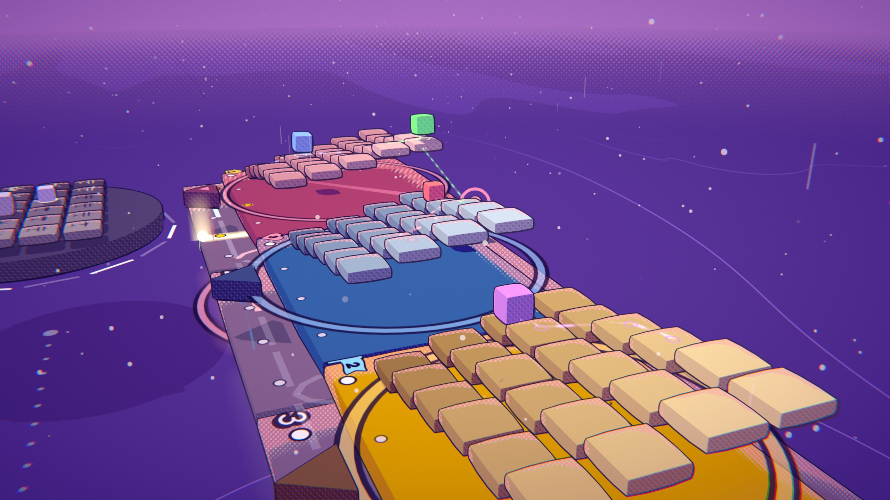
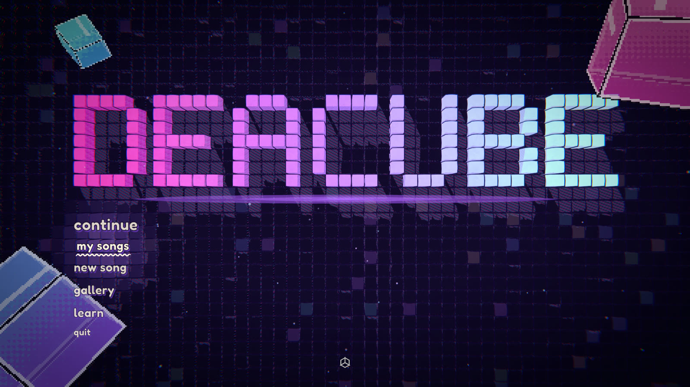
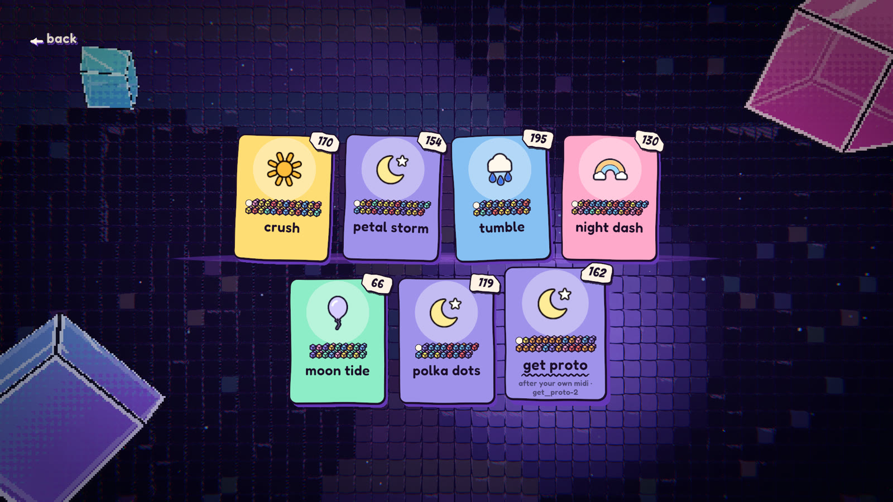
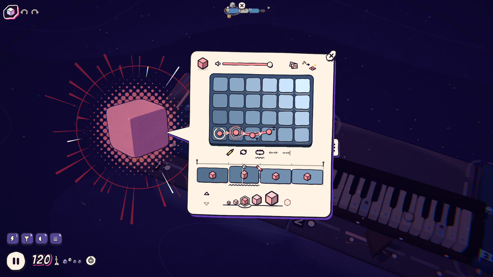
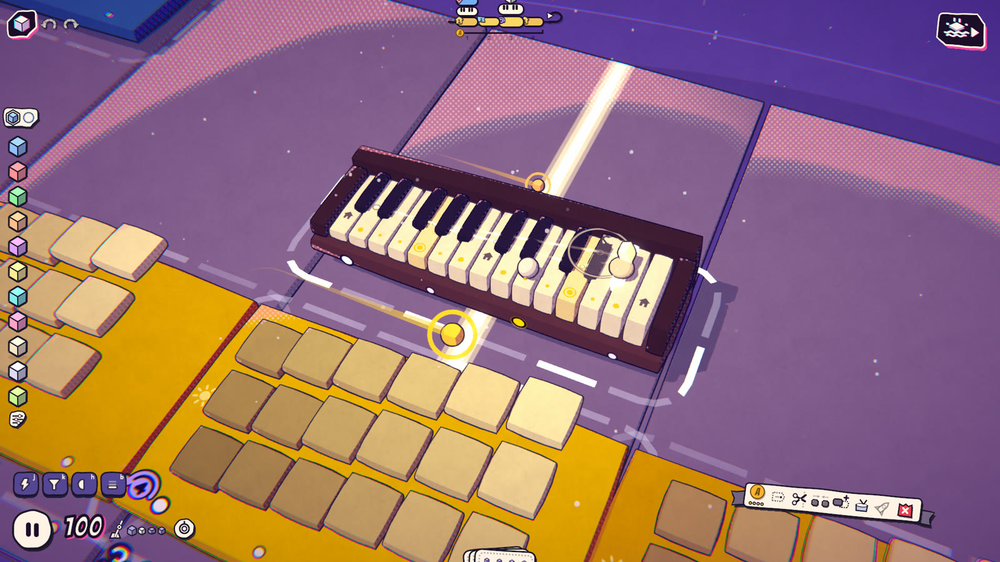
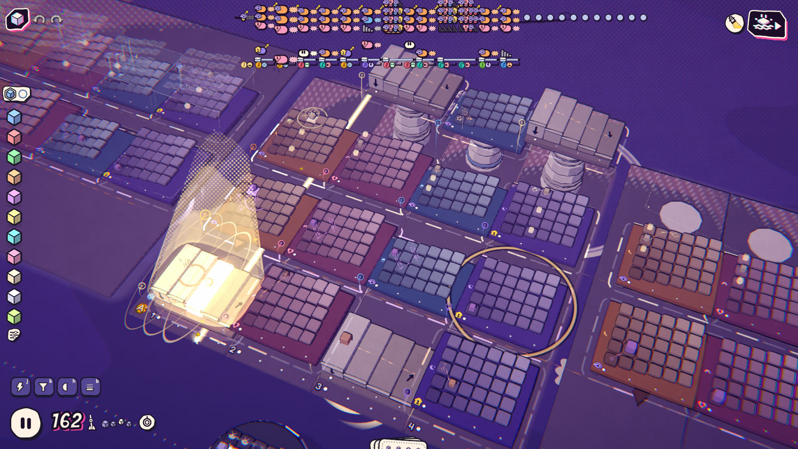
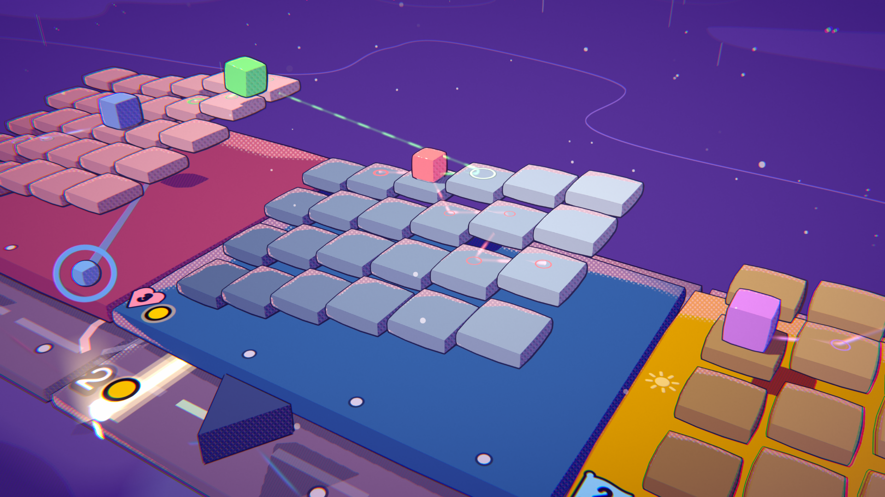

<div align="center">

# DeaCube

[](#installation)
[](#how-it-works)
[](#quality-checks)
[](#limitations)

</div>

<p align="center"></p>

## Overview

DeaCube is a spatial music composition software that aims to simplify its process by:

1. Handling the "music theory" semantics by pre-tuning chord selection to a genre
2. Following a building-block design, where measures are blocks and sections are islands
3. Intuitive paths and melody creation through spatial sequencing

Have fun!

## How it works

```
┌──────────────────────────────────────────────┐
│  VIBE         a prompt or the dice → chords  │
└──────────────────────┬───────────────────────┘
                       ▼
┌──────────────────────────────────────────────┐
│  ISLANDS      each chord rises as a grid     │
└──────────────────────┬───────────────────────┘
                       ▼
┌──────────────────────────────────────────────┐
│  PATHS        a cube walks a path you trace  │
└──────────────────────┬───────────────────────┘
                       ▼
┌──────────────────────────────────────────────┐
│  ARRANGE      columns, voice lanes, sections │
└──────────────────────┬───────────────────────┘
                       ▼
┌──────────────────────────────────────────────┐
│  DEVICES      repeat, stairs, launch, echo   │
└──────────────────────┬───────────────────────┘
                       ▼
┌──────────────────────────────────────────────┐
│  PLAY         MeltySynth on the audio thread │
└──────────────────────┬───────────────────────┘
                       ▼
┌──────────────────────────────────────────────┐
│  PRESENT      islands rise from the sea      │
└──────────────────────────────────────────────┘
```

<table>
  <tr>
    <td width="50%"></td>
    <td width="50%"></td>
  </tr>
  <tr>
    <td width="50%"></td>
    <td width="50%"></td>
  </tr>
  <tr>
    <td width="50%"></td>
    <td width="50%"></td>
  </tr>
</table>

## Installation

Requirements: Unity 6000.4 with URP. A [Gemini API key](https://aistudio.google.com/app/apikey) is optional and only used to turn a written vibe into a progression.

```sh
git clone https://github.com/EthanChen5291/deacube.git
cd deacube
cp AudioCube_Unity/Assets/StreamingAssets/api_config.env.example \
   AudioCube_Unity/Assets/StreamingAssets/api_config.env      # GEMINI_API_KEY=...   (optional)
```

The env file is gitignored. The instrument bank (`GeneralUser-GS.sf2`, 32 MB) ships in `StreamingAssets`.

## Quick start

Open `AudioCube_Unity/` in Unity Hub, open `Assets/Scenes/SampleScene.unity` and press Play. Choose **learn** on the title screen for a guided first song, **new song** to describe a vibe, or **gallery** to open a finished one.

| Key | Does |
|---|---|
| Space | play / pause |
| 1–9, 0 | pick up an instrument cube |
| I | the deck of chord cards |
| P | present mode |
| ? | the shortcut sheet |

## Quality checks

The checks run inside Play mode from the editor and drive the mouse and keyboard by simulation (`Assets/DeaCube/Tests`). `V7Suites.RunAll(true, "")` runs every suite and writes `Captures/<suite>_report.txt` plus screenshots. Pass suite names to run a subset.

```csharp
V7Suites.RunAll(true, "V9ChecksProto,V9ChecksLights")
```

There is no Test Runner suite.

## Repository

| Path | Contents |
|---|---|
| `AudioCube_Unity/Assets/` | Scene scripts: song, path and island managers, cubes, clock, camera, HUD |
| `AudioCube_Unity/Assets/DeaCube/` | Menu, tutorial, inspector, island headers, deck, present mode, look (toon shaders, `Ink/` kit and HUD), theory, state; `Audio/` holds SynthEngine and the vendored MeltySynth; `Tests/` holds the Play-mode checks |
| `AudioCube_Unity/Assets/Resources/Gallery/` | The gallery's seven songs and their index |
| `tools/gallery/` | The python3 builder for the gallery songs and MIDI imports |
| `docs/` | Design specs for v2 to v7, the gallery notes, [controls](docs/controls.md), [architecture](docs/architecture.md), README images in `media/` |
| `AudioCube/` | Earlier JUCE prototype of a native audio backend; not used by the Unity scene |

## Acknowledgements

[MeltySynth](https://github.com/sinshu/meltysynth) (MIT) for the SoundFont synthesizer, [GeneralUser GS](https://www.schristiancollins.com/generaluser) by S. Christian Collins for the instrument bank, [Fredoka](https://github.com/google/fonts/tree/main/ofl/fredoka) and [Bangers](https://github.com/google/fonts/tree/main/ofl/bangers) (SIL OFL) for the type, [Google Gemini](https://aistudio.google.com) for chord generation, [Tonecraft](https://experiments.withgoogle.com/tonecraft), Melatonin, Mix Universe and *Spider-Man: Into the Spider-Verse* for inspiration, and Unity for the sequencer environment.
